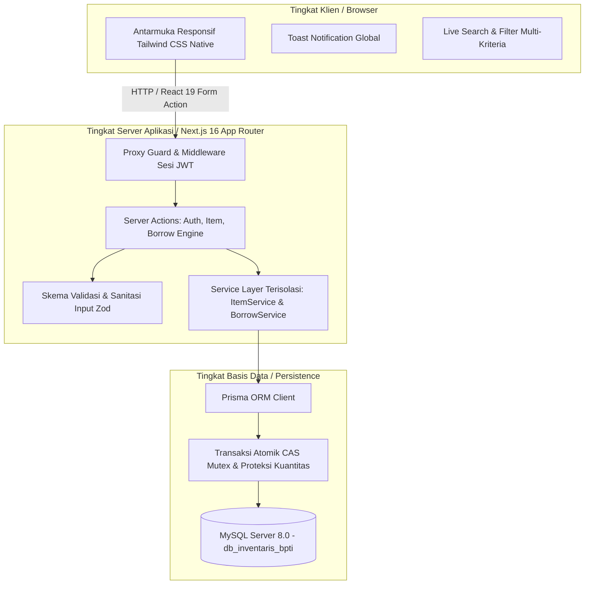
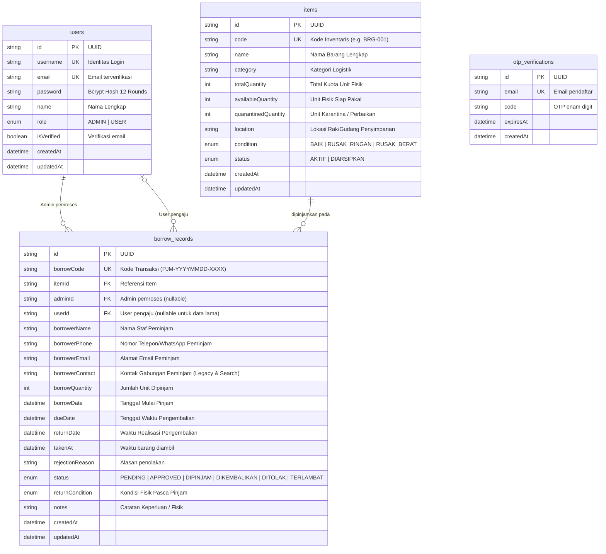

# SISTEM INFORMASI PENGELOLAAN BARANG INVENTARIS KANTOR
## Badan Pengembangan Teknologi Informasi (BPTI) UHAMKA
### Dokumentasi Teknis, Arsitektur Sistem, Manual Operasional & Panduan Pengujian

---

## 1. Ringkasan Eksekutif & Gambaran Umum

Sistem Pengelolaan Barang Inventaris BPTI UHAMKA adalah platform web administratif tingkat kampus yang dirancang khusus untuk mencatat ribuan unit aset logistik, mengelola mutasi sirkulasi peminjaman staf, memantau batas waktu pengembalian (*due date*), serta menjaga integritas stok fisik secara *real-time* dan akuntabel.

Sistem dioperasikan pada lingkungan jaringan lokal (*On-Premise Intranet*) dengan kontrol akses berbasis peran (RBAC): Admin mengelola master barang dan sirkulasi, sedangkan User terverifikasi melihat katalog, mengajukan peminjaman, dan memantau riwayatnya.

---

## 2. Arsitektur Perangkat Lunak (*Three-Tier Architecture*)

Sistem dibangun dengan memisahkan tanggung jawab secara tegas (*Separation of Concerns*):



### Spesifikasi Tumpukan Teknologi (*Tech Stack*):
- **Framework Aplikasi:** Next.js 16.3.7 (App Router, Turbopack, React 19.2 Server Components & Actions)
- **Bahasa Pemrograman:** TypeScript 5.x (Strict Type Checking)
- **Styling & Desain:** Vanilla Tailwind CSS (Sistem Desain Khusus BPTI, Dark/Light Mode Adaptif)
- **Tipografi:** Geist Sans & Geist Mono (Vercel)
- **Basis Data:** MySQL Server v8.0 / MariaDB (Port 3306)
- **Object-Relational Mapping (ORM):** Prisma ORM v5.22.0
- **Keamanan:** Bcrypt.js (Salt rounds 12), Jose JWT HS256 HttpOnly Cookie
- **Ikonografi:** Lucide React

---

## 3. Matriks Pembagian Peran Rekayasa Tim Pengembang

Mengacu pada *Project Charter* dan dokumen *SRS (Software Requirements Specification)*, rekayasa sistem ini dikerjakan oleh tim 4 mahasiswa PKL:

| Peran Rekayasa | Fokus Tanggung Jawab Utama | Berkas Implementasi Terkait |
| :--- | :--- | :--- |
| **Dev 1 (Lead Project, DB & Security)** | Perancangan skema relasional, keamanan Bcrypt, JWT, Route Guard, dan dokumentasi resmi. | `prisma/schema.prisma`, `lib/auth.ts`, `lib/session.ts`, `proxy.ts`, `README.md` |
| **Dev 2 (Frontend Specialist & Validation)** | Pembuatan layout dasbor, komponen modal, skema validasi Zod berbahasa Indonesia baku. | `app/(dashboard)/**`, `components/items/item-modal.tsx`, `lib/validations/**` |
| **Dev 3 (Backend Engineer & Circulation)** | Logika mutasi stok atomik, isolasi race condition, agregasi metrik, dan proteksi foreign key. | `actions/borrow-actions.ts`, `actions/item-actions.ts`, `prisma/seed.ts` |
| **Dev 4 (QA/QC)** | Pengujian otomatis UAT, sistem Toast notification native. | `scripts/run-phase3-uat.ts`, `scripts/scan.mjs`, `components/ui/toast.tsx` |

---

## 4. Prasyarat Lingkungan Operasional

Sebelum menjalankan aplikasi, pastikan komputer server/lokal telah terpasang:
1. **Node.js LTS**: Versi 20.x, 22.x, atau 24.x (disarankan v24.x).
2. **Package Manager**: `pnpm` versi 9.x atau 11.x (`corepack enable && corepack prepare pnpm@latest --activate`).
3. **Database Server**: MySQL Server v8.0 atau MariaDB aktif pada port `3306`.
4. **Browser Modern**: Google Chrome, Mozilla Firefox, Microsoft Edge, atau Safari.

---

## 5. Panduan Instalasi & Setup Langkah demi Langkah

### Langkah 1: Kloning / Akses Repositori
```bash
cd c:/bpti-project-inventaris
```

### Langkah 2: Instalasi Dependensi
```bash
pnpm install
```

### Langkah 3: Konfigurasi Variabel Lingkungan (`.env`)
Pastikan berkas `.env` berada di direktori root dengan konfigurasi berikut:
```env
DATABASE_URL="mysql://root:@localhost:3306/db_inventaris_bpti"
SESSION_SECRET="bpti-inventory-secure-session-secret-key-2026-min-32-chars"
GMAIL_USER="akun-gmail-pengirim@gmail.com"
GMAIL_APP_PASSWORD="password-aplikasi-gmail"
NODE_ENV="development"
```

`GMAIL_USER` dan `GMAIL_APP_PASSWORD` diperlukan untuk mengirim OTP saat User mendaftar. Gunakan Gmail App Password dan simpan hanya di `.env` lokal/server; jangan masukkan kredensial ke Git.

### Langkah 4: Sinkronisasi Skema Basis Data
Terapkan skema tabel relasional ke basis data MySQL:
```bash
pnpm db:push
```

### Langkah 5: Seeding Data Awal (Akun Admin & Master Aset)
Inisialisasi akun administrator dan data master barang bawaan BPTI:
```bash
pnpm db:seed
```

### Langkah 6: Menjalankan Server Pengembangan
```bash
pnpm dev
```
Buka peramban pada alamat `http://localhost:3000`.

---

## 6. Kredensial Otentikasi Bawaan (*Default Credentials*)

Gunakan akun berikut untuk masuk ke sistem:
- **URL Login:** `http://localhost:3000/login`
- **Username:** `admin`
- **Password:** `admin123`
- **Masa Berlaku Sesi:** 7 hari kalender (JWT HS256 HttpOnly Cookie).

Pendaftaran melalui `/register` selalu membuat akun ber-role `USER`. User harus memverifikasi email OTP sebelum dapat masuk. `pnpm db:seed` memastikan akun `admin` ber-role Admin dan juga memasukkan barang contoh.

---

## 7. Kamus Basis Data Relasional (ERD & Tabel)



### Aturan Integritas Matematika Persamaan Stok:
$$\text{Total Unit Fisik} = \text{Unit Siap Pakai} + \text{Unit Sedang Dipinjam} + \text{Unit Karantina / Perbaikan}$$
Persamaan ini dijaga secara mutlak oleh blok transaksi `prisma.$transaction`.

---

## 8. Manual Operasional Pengguna (SOP Admin)

### SOP-01: Pendaftaran Master Aset Baru (FR-ITEM-01)
1. Buka menu **Master Barang** (`/barang`).
2. Klik tombol **Tambah Barang**.
3. Isi Kode Barang, Kategori, Nama Barang, jumlah unit, dan Lokasi Simpan. Gambar barang bersifat opsional; format yang didukung JPG, PNG, atau WebP dengan ukuran maksimal 5 MB.
4. Klik **Tambah Barang**. Tombol **Lihat Gambar** pada baris tabel membuka gambar beserta keterangan nama, kode, kategori, dan lokasi barang.

Gambar disimpan sebagai data biner di tabel `item_images` pada MySQL dan ikut dimasukkan ke berkas backup/restore basis data.
Setelah memperbarui skema pada instalasi yang sudah ada, jalankan `pnpm db:push` untuk membuat tabel tersebut.


### SOP-02: Transaksi Sirkulasi Peminjaman Aset (FR-TRX-01)
1. User memilih barang di katalog, lalu mengisi jumlah, tanggal pinjam/kembali, dan catatan keperluan.
2. Sistem membuat pengajuan berstatus `PENDING` dan mereservasi kuota permintaan tanpa mengurangi stok fisik.
3. Admin membuka **Sirkulasi Peminjaman** (`/sirkulasi`) untuk memilih **ACC / Setujui** atau **Tolak** dengan alasan.
4. Setelah barang secara fisik diambil di kantor, Admin memilih **Barang Sudah Diambil**; pada tahap ini stok `availableQuantity` berkurang.
5. Peminjaman yang dicatat langsung oleh Admin tetap mengurangi stok secara atomik dan menerbitkan kode transaksi `PJM-YYYYMMDD-XXXX`.

### SOP-03: Pengembalian Aset & Inspeksi Kondisi Fisik (FR-TRX-02)
1. Buka menu **Sirkulasi Peminjaman** (`/sirkulasi`).
2. Temukan transaksi yang berstatus `Dipinjam`, lalu klik tombol **Kembalikan**.
3. Pilih kondisi fisik unit yang diserahkan kembali (*BAIK*, *RUSAK RINGAN*, atau *RUSAK BERAT*).
4. Tambahkan catatan kondisi bila terdapat perubahan fisik pada unit.
5. Klik **Konfirmasi Pengembalian**. Sistem memulihkan kuota unit siap pakai dan memperbarui status menjadi `Selesai Dikembalikan`.

### SOP-04: Penanganan Peringatan Keterlambatan Sirkulasi (FR-UI-01)
1. Periksa halaman **Ringkasan Dasbor** (`/`).
2. Jika ada transaksi yang melewati tenggat waktu kembali (*due date*), banner peringatan merah akan muncul di bagian atas dasbor dengan jumlah transaksi terlambat.
3. Klik tombol **Tinjau Transaksi** untuk langsung menuju ke daftar peminjaman terlambat guna melakukan penagihan fisik kepada staf terkait.

### SOP-05: Pencarian & Penyaringan Multi-Kriteria (FR-ITEM-02 & FR-TRX-03)
- Pada menu Master Barang: Gunakan kotak pencarian instan (*live search*) untuk memfilter data berdasarkan kode, nama, atau lokasi tanpa perlu memuat ulang peramban. Filter kategori dan filter kondisi fisik dapat dikombinasikan secara bebas.
- Pada menu Sirkulasi: Filter transaksi berdasarkan status, termasuk menunggu persetujuan, disetujui, ditolak, sedang dipinjam, dikembalikan, dan terlambat.

### SOP-06: Pendaftaran User & Pengajuan Peminjaman
1. User mendaftar di `/register` menggunakan nama, username, email, dan kata sandi.
2. Masukkan kode OTP enam digit yang dikirim ke email. Kode berlaku selama lima menit.
3. Setelah masuk, buka **Master Barang** untuk melihat jumlah stok tersedia dan ajukan peminjaman barang.
4. Pantau status melalui **Riwayat Peminjaman**. Pengajuan yang disetujui dapat diambil di kantor BPTI; jika ditolak, alasan Admin tersedia pada detail pengajuan.

---

## 9. Rangkaian Perintah Skrip Resmi (*CLI Utility Scripts*)

Repositori ini dilengkapi dengan perintah skrip terstandardisasi pada `package.json`:

| Perintah | Deskripsi Fungsi |
| :--- | :--- |
| `pnpm dev` | Menjalankan server aplikasi Next.js dalam mode pengembangan lokal (`localhost:3000`). |
| `pnpm build` | Mengompilasi aplikasi untuk lingkungan produksi menggunakan Turbopack. |
| `pnpm start` | Menjalankan server build produksi lokal. |
| `pnpm typecheck` | Memvalidasi seluruh tipe TypeScript secara ketat tanpa menghasilkan berkas keluaran. |
| `pnpm lint` | Menjalankan pemeriksaan ESLint pada seluruh berkas proyek. |
| `pnpm test:uat` | Menjalankan test runner otomatis 11 kasus uji (UAT-01 s/d UAT-10 + STRESS-01) dengan database safety guard. |
| `pnpm test:audit` | Menjalankan test runner otomatis audit trail & telemetri log aktivitas (`scripts/run-audit-uat.ts`). |
| `pnpm db:check` | Memeriksa agregat kuota stok fisik dan riwayat sirkulasi terkini langsung ke basis data MySQL. |
| `pnpm db:push` | Menerapkan perubahan skema Prisma ke basis data MySQL secara langsung. |
| `pnpm db:seed` | Menjalankan seeding akun default admin (Bcrypt salt 12) dan master barang BPTI. |
| `pnpm db:studio` | Membuka antarmuka grafis visual Prisma Studio untuk inspeksi basis data di peramban. |
| `pnpm db:backup` / `scripts/backup-db.bat` | Membuat snapshot cadangan data relasional lengkap ke format JSON di folder `backups/`. |
| `pnpm db:restore` / `scripts/restore-db.bat` | Memulihkan basis data secara utuh dari snapshot cadangan JSON (Clean & Repopulate Transaction). |

> [!NOTE]
> Laporan lengkap pemenuhan dan resolusi seluruh temuan audit teknis dapat ditinjau pada dokumen [Laporan Resolusi Audit Gap](docs/AUDIT_GAPS_RESOLUTION.md).

---

## 10. Jaminan Keamanan Sistem & Ketahanan Transaksi ACID

1. **Pencegahan Kondisi Balapan (Conditional CAS Mutex):**
   Pengurangan kuota unit menggunakan klausa `WHERE availableQuantity >= borrowQuantity AND status = 'AKTIF'`. Transaksi gagal otomatis di tingkat basis data bila kuota tidak mencukupi atau barang diarsipkan, mencegah stok bernilai negatif (*zero negative stock*).
2. **Idempotensi Pengembalian (Anti Double-Return):**
   Pengembalian dibatasi oleh predikat `WHERE status = 'DIPINJAM'`. Percobaan kedua pada transaksi yang sama ditolak seketika, mencegah manipulasi pemulihan stok ganda.
3. **Integritas Relasional MySQL (`onDelete: Restrict`):**
   Barang yang memiliki riwayat transaksi peminjaman tidak dapat dihapus dari tabel master demi menjaga akuntabilitas audit sejarah aset institusi.
4. **Keamanan Kredensial & Sesi Admin:**
   Sandi di-hash dengan Bcrypt 12 rounds (kebal terhadap *rainbow table* dan *timing attack*). Token sesi JWT menggunakan algoritma `HS256` yang disimpan dalam cookie `HttpOnly`, `SameSite=Lax`, dan `Path=/`.
5. **Keterbatasan Sistem Saat Ini (*Known Limitations*):**
   - **Model Inventaris:** Berbasis kuantitas unit agregat per item (`totalQuantity`, `availableQuantity`), belum pelacakan per serial number individual fisik (RFID/Barcode).
   - **Manajemen Sesi:** Daftar token sesi yang dicabut (*revocation list*) saat ini tersimpan di memori proses lokal (*In-Memory Set*), sehingga restart server akan mereset cache token yang dicabut.
   - **Pengiriman OTP:** Pendaftaran User memerlukan konfigurasi Gmail App Password pada environment server. Pengiriman email nyata perlu diuji menggunakan akun SMTP yang telah dikonfigurasi.

---

## 11. Pengesahan & Serah Terima Proyek

Dokumentasi ini disusun sebagai bagian dari laporan akhir Praktik Kerja Lapangan (PKL) Program Studi Teknik Informatika Universitas Muhammadiyah Prof. DR. HAMKA (UHAMKA) yang bermitra dengan Badan Pengembangan Teknologi Informasi (BPTI) UHAMKA.
